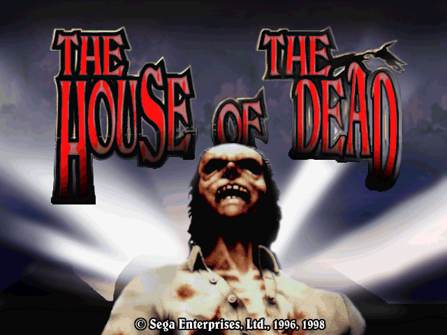
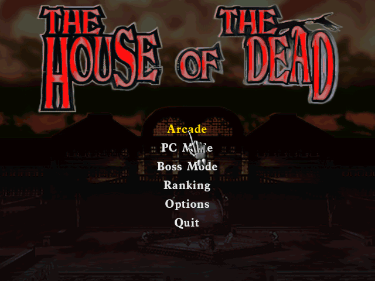
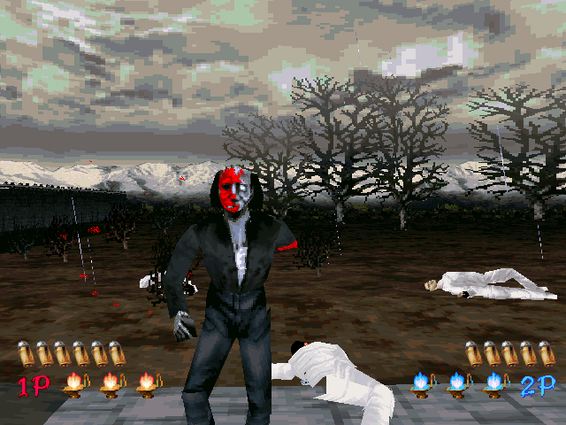
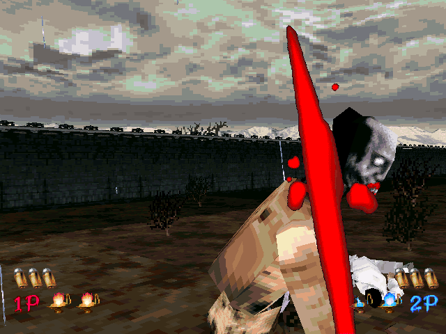
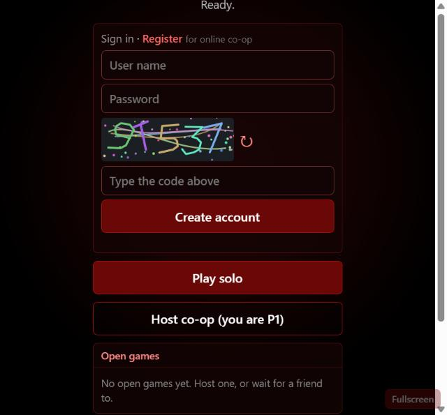
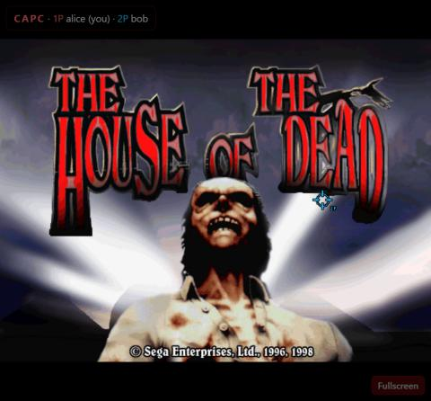

# The House of the Dead (PC, 1998) — web port

A static recompilation of Sega's 1998 Windows port of *The House of the Dead* to portable C, with the Win32 /
DirectX layer replaced by SDL2. It builds a native SDL2 executable and a WebAssembly build that runs in a
browser tab, including two-player co-op over the network.

**This repository contains no game code or data.** Everything game-derived (the generated C in `gen/`, the
analysis in `build/`, the packaged web data in `build_web/`) is produced locally from **your own installed
copy** and is ignored by git. Research and educational use only; bring your own legally obtained copy and do not
redistribute builds — they contain the game's data.

## Screenshots

Captured from the recompiled game (the original software renderer, 640×480).

| | |
|---|---|
|  |  |
| Title screen | Main menu: the hand follows the mouse |
|  |  |
| Two-player co-op: 1P and 2P HUDs | Stage 1 gameplay |

In the browser: the start screen (solo, sign in / register with the server's captcha, the open games list) and
P2's crosshair as P1 sees it during an online game.

| | |
|---|---|
|  |  |

## Quick start

You need Python 3.9+, git, and (for online co-op and accounts) Node.js 22.13+ (it uses the built-in
`node:sqlite`). Everything else is fetched on first use.

```bash
python port.py --game "C:/Games/House of the Dead"
```

That one command:

1. checks `THOTD.EXE` in your game folder and installs the Python packages it needs (`capstone`, `pefile`);
2. analyses the executable (`tools/cap_export.py`) and recompiles it to C (`tools/recomp.py` → `gen/`);
3. installs Emscripten into `.emsdk/` if it is not already on the machine (about 1 GB, once);
4. packages the game files and builds `build_web/out/`;
5. serves it at <http://localhost:8080>.

Other commands:

| Command | What it does |
|---|---|
| `python port.py --game DIR web` | build the web version only |
| `python port.py --game DIR native` | native SDL2 build (`build/hotd_port`); needs gcc or clang (SDL2 is fetched on Windows, use your package manager elsewhere) |
| `python port.py serve [--port 8080] [--password secret]` | serve the last web build, accounts and co-op rooms |
| `python port.py --game DIR gen --force` | redo the analysis and code generation |

### What the game folder needs

`THOTD.EXE` plus the data folders `ART`, `CAM`, `EVT`, `SOUND`, `SPRITE` and the `*.PAL` / `*.TBL` / `*.CFG`
files from a normal install. CD music is optional: rip the audio tracks from the game CD to
`MUSIC/track02.wav … MUSIC/track12.wav` (installs patched with the `_inmm` CD-audio emulator already have them).
With `ffmpeg` on the PATH the web build converts them to Ogg Vorbis.

Tested builds of `THOTD.EXE` are listed in `port.py` (`KNOWN_EXES`). Other builds may work: the analysis is
automatic, but `recomp_config.json` names a few addresses of the tested builds.

## Playing

- **Aim** with the mouse (the pointer is a crosshair), **left button** fires, **right button** reloads (it fires
  off screen, as on the arcade cabinet). **Space** skips scenes; menus are clicked.
- **Online co-op (P1 + P2):** sign in (or register: user name, password and a captcha drawn by the server).
  P1 clicks **Host co-op**; the room appears in everyone's **Open games** list, or share its 4-letter code /
  the page address. P2 clicks **Join**. P1 clicks **Start game** (P2 can also join a game already running: their
  browser replays it from the start, which takes a moment). Each player aims with their own mouse and sees the
  partner's crosshair in blue/red. Only input travels: both browsers run the same game in lockstep, checked by a
  state checksum every second.
- Friends join **your** server, so they load the build from you: keep it private (`--password`) and only share
  it with people who own the game. For play over the internet, put the server behind HTTPS (a tunnel or a small
  VPS with Caddy) — the page then uses `wss://` automatically.

### Accounts

Accounts live in `server/data/hotd.db` (SQLite; git-ignored): scrypt-hashed passwords, random session tokens
and a games-played counter. `node server/adduser.js <name> <password>` creates an account without the form.

## How it works

- `tools/cap_export.py` — a capstone-based analysis of the Watcom-built exe (recursive descent from the entry
  point, the export table and every relocated pointer; Watcom jump tables in the code segment), writing the
  JSON that `recomp.py` reads (the same format as the IDA exporter of the
  [game-web-port skill](https://github.com/un4ckn0wl3z/game-web-port-skill)).
- `tools/recomp.py` — the skill's static recompiler, extended for Watcom flat-model code (segment registers,
  `enter`, 16-bit `pushf`/`popf`, `aam`, register-argument `setjmp`/`longjmp`).
- `src/` — runtime and shims: `ddraw.c` (DirectDraw 2 on an SDL renderer, 8/16-bit surfaces), `dinput.c`,
  `dsound.c`, `cdmusic.c` (MCI CD audio from `MUSIC/`), `hotd_shims.c` (kernel32/user32/GDI/WinMM extras and
  `gamebios.dll`, the arcade light-gun API, emulated with two mouse-driven guns), `netplay.c` (lockstep co-op).
- `web/`, `server/` — the page and the Node.js relay for online rooms.

## Debugging switches (native and web console)

| Variable | Effect |
|---|---|
| `PORT_SHOT=100,500` | save the frame to `shot_00100.bmp` at those frames |
| `PORT_EXIT=N` | quit after N frames |
| `PORT_INPUT="900:fire:320,240;960:key:0x20;1300:fire2:300,250"` | scripted input by frame (`fire2`: P2's gun) |
| `PORT_NET_TEST=1 PORT_NET_RECORD=a.rec` | run as a co-op host with the virtual clock, log checksums, record bundles |
| `PORT_NET_REPLAY=a.rec PORT_NET_VIEW=1` | replay them as P2 and report any desync |
| `PORT_CONTROLS=original` | keep the game's own control settings instead of the two light guns |
| `PORT_DDLOG=1` | log DirectDraw calls |
| `PORT_TRACE=trace.txt` | with `port.py native --trace`: first frame and call count of every guest function |

`port.log` records every shim's first use and any unimplemented call. `tools/dev/` has small helpers
(disassembly, cross references, gdb hit tracing) and `tools/ghidra/DecompileAll.java` writes a Ghidra
decompilation to `build/analysis/decomp.c` for reading.

## Status (verified 2026-10-26)

- **Native (Windows, MinGW + SDL2):** title, menus, Arcade mode, the intro and stage 1 gameplay with shooting;
  P2 joins with the second gun. CD music from `MUSIC/`.
- **Lockstep:** a recorded 2-player session (P1 and P2 both shooting) replays as P2 with all 32 checksums equal,
  and two independent host runs produce identical checksums.
- **Web (Chrome-based embedded browser):** loads, menus and Arcade start; two tabs played the same game in
  lockstep (P1 hosted, P2 joined from the open games list) without desync. Frame rate was not measured in a real
  browser yet (the embedded test browser throttles animation frames).
- Not done yet: D3D (hardware) renderer path (the game runs its software renderer), the options screen's
  control remapping (both players are always light guns), sound effects not checked by ear.
